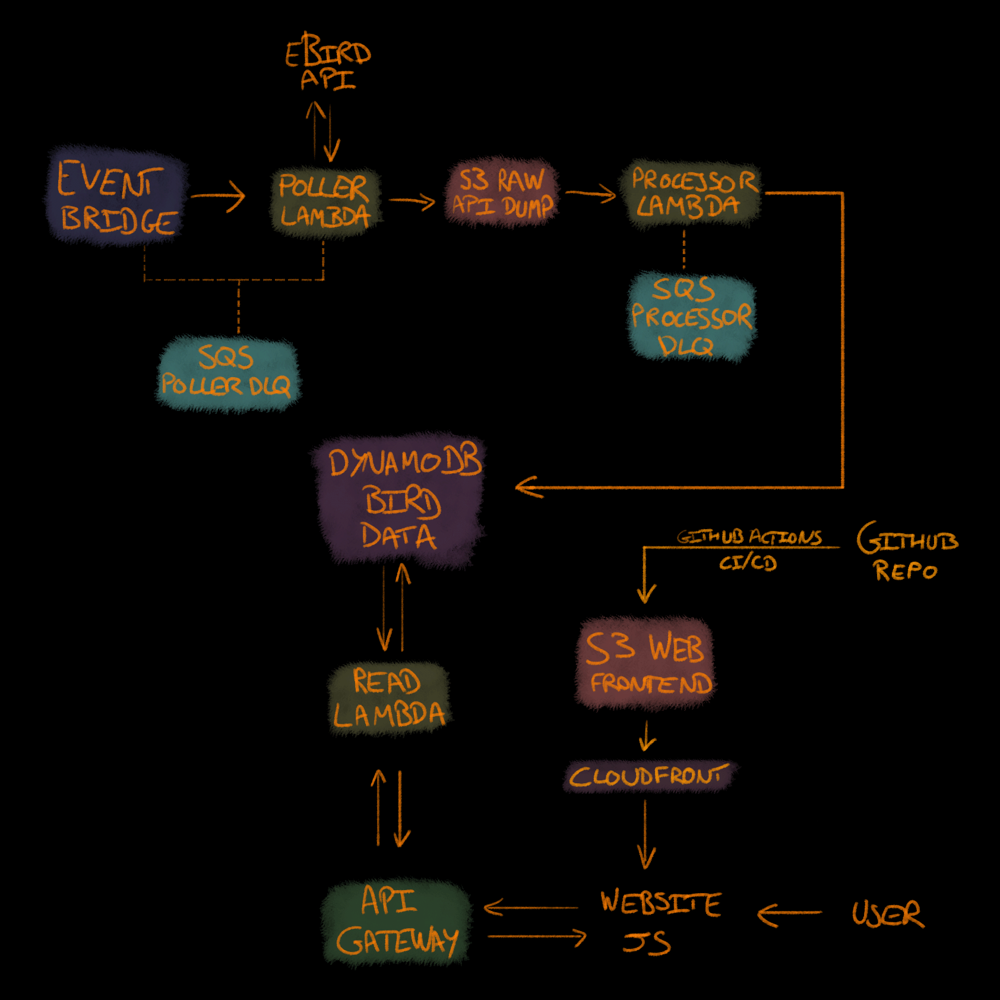

# BirdAlert 𓅪


BirdAlert collects notable bird sightings from eBird for configured UK regions and displays them on a public website. It keeps a reusable record of sightings behind a read API. The longer-term aim is to let people follow species and receive email alerts for sightings near them.

I'm building it as a practical AWS and Terraform portfolio project: one useful application where I can work through ingestion, data quality, deployment, and failure handling. It also gives me a way to practise agent-assisted development while keeping ownership of the architecture and reviewing the results. The design is serverless, modular, and intended to keep running costs and maintenance low.

## Current status

Phase 1 is implemented: scheduled ingestion, validation and deduplication, DynamoDB storage, a public read API, a static homepage, and operational monitoring. The homepage shows the latest 10 sightings and the last successful processing time. The API supports combined region, species, and UK calendar-date filters, with bounded pagination; its health check verifies database access.

The [roadmap](docs/ROADMAP.md) records the earlier **dev** deployment and live verification on **15 October 2026**. Dev infrastructure is now decommissioned. The recorded checks cover scheduled ingestion, raw S3 storage, processor completion, homepage freshness, and a synthetic processor failure that exhausted retries, reached its dead-letter queue, raised CloudWatch alarms, and triggered a successful SNS alarm action. That SNS action is not evidence of email delivery to an inbox.

The existing production homepage remains live at `birdalert.gatherer.tech`. The non-destructive handoff of its website S3 objects has been applied in production; Terraform continues to manage the hosting infrastructure. The recorded dev checks do not establish production test results. Poller execution-failure, EventBridge delivery-failure, and stale-processing simulations remain future resilience drills. Authentication, watchlists, and personalised alerts are not implemented.

## AWS architecture



```text
EventBridge (every 15 minutes) -> Poll Lambda -> eBird API (back=1)
Poll Lambda -> private raw S3 -> S3 event -> Processor Lambda -> DynamoDB
Browser -> API Gateway -> Read Lambda -> DynamoDB
Browser -> CloudFront -> separate private S3 site bucket

Failed poller/processor deliveries -> separate SQS dead-letter queues
CloudWatch problem alarms -> SNS -> optional administrator email
```

The poller reads the eBird key from Parameter Store and saves complete responses under region-based S3 prefixes. Raw responses currently have a one-day lifecycle; retention and source regions are deployment settings.

The processor validates each response and stores sightings when first seen. The 15-minute schedule is a polling heartbeat, not a filter on observation time, so late-submitted reports within the upstream window can still be ingested. Batch identity checks avoid repeat writes, and conditional transactions protect against duplicates. DynamoDB keeps one canonical sighting plus small indexed query records for bounded reads without table scans or a separate cache. Processed sightings currently have no expiry.

Private-location sightings are excluded entirely from processed storage. Well-formed unvalidated reports are retained as provisional and labelled accordingly. Complete upstream responses remain restricted to raw S3. Stored timestamps use UTC; date filters and display use `Europe/London`.

The homepage fetches data once on page load. CloudFront caches static assets and accesses only the site bucket through Origin Access Control; sightings come directly through the API. DynamoDB uses on-demand billing, and configurable API throttles limit request rates without guaranteeing a spending cap.

Transient eBird failures receive up to three retries. Separate encrypted SQS queues retain failed deliveries for 14 days for investigation and manual replay. CloudWatch retains logs for 30 days and alarms on function errors, queued failures, sustained API errors, and 45 minutes without processing completion. SNS notifications are for operational problems; routine successful polls do not generate email.

## Terraform and development

Terraform is the source of truth for AWS infrastructure:

- `terraform/bootstrap/` provisions the private, encrypted, versioned S3 remote-state bucket.
- `terraform/root/` assembles the application from modules in `terraform/modules/`, including storage, Lambda, scheduling, API, static hosting, IAM, and monitoring.
- `terraform/backend/` selects separate dev and production state locations with state locking. Changing a variable file alone does not select the environment.
- `terraform/environments/` supplies environment settings. Production configuration includes ACM and Route 53 for the custom domain.

IAM permissions are scoped to each function's work, including its own Terraform-created log group. Secrets belong in Parameter Store and local deployment inputs, never in committed configuration or logs.

This repository owns the Python Lambda and API code in `src/`, local tests in `tests/`, and AWS infrastructure. Frontend source, including the legacy homepage, is in `BirdAlert-Frontend/main`. Terraform manages the hosting infrastructure but no longer defines the website objects. `python build_lambdas.py` builds all three Lambda packages. See the [development guide](docs/DEVELOPMENT.md) for prerequisites, local checks, backend selection, deployment, and recovery. Local tests and mocked Terraform tests do not establish live AWS behaviour.

## Planned work

The Svelte application in **BirdAlert-Frontend** is the future frontend; the existing homepage remains in place until its replacement is approved. The frontend's `main` branch has `.github/workflows/frontend-ci.yml`, a manually triggered pipeline with sequential placeholder Test, Build, and Deploy jobs that print messages only. It does not run tests, build, upload, or deploy. Real frontend deployment, environment-specific API configuration, and deployment rules remain to be designed. Any future production deployment requires explicit approval.

Phase 2 will add:

- Cognito authentication, using email as the username.
- Species and region watchlists.
- A registered location and an editable alert radius in miles.
- Matching newly processed sightings against user preferences and sending personalised email alerts through SNS.

Location storage, geolocation, distance calculation, and the Cognito schema still need Phase 2 design. International coverage would also need explicit timezone and date-handling decisions. Analytics, AI product features, mobile apps, social features, and complex recommendations remain outside the agreed scope.

## Project documentation

- [Bible](docs/BIBLE.md): authoritative product intentions and scope.
- [Architecture](docs/ARCHITECTURE.md): data flow, storage, and implementation details.
- [Design decisions](docs/DECISIONS.md): the reasoning behind architectural choices.
- [Requirements](docs/REQUIREMENTS.md): expected behaviour and security boundaries.
- [Development guide](docs/DEVELOPMENT.md): build, validation, deployment, and recovery procedures.
- [Roadmap](docs/ROADMAP.md): milestones, recorded verification, and future work.
